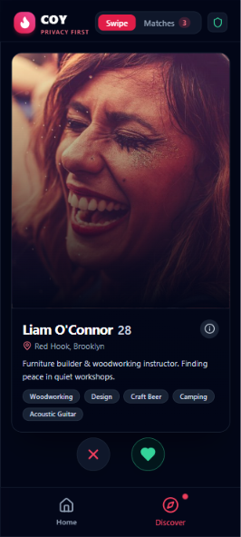
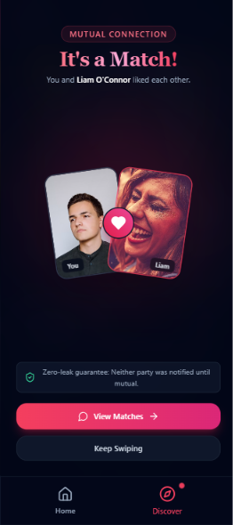
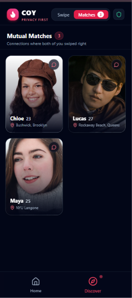

# Coy Discover Tab: SDE Intern Assignment (Part B)

Standalone app built for the Coy SDE Intern assignment. Coy is a double-blind crush-matching app; this adds a swipe-based Discover tab that preserves its core privacy promise.

---

## Table of Contents
1. [Tech Stack & Architecture](#tech-stack--architecture)
2. [Monorepo Structure](#monorepo-structure)
3. [Setup & Running Locally](#setup--running-locally)
4. [Database Schema](#database-schema)
5. [API Documentation](#api-documentation)
6. [Zero-Leak Privacy Guarantees](#zero-leak-privacy-guarantees)
7. [Running Tests](#running-tests)
8. [Demo Guide: Seeded Incoming Likes](#demo-guide-seeded-incoming-likes)
9. [Screenshots](#screenshots)
10. [Deployment Notes](#deployment-notes)
11. [Troubleshooting](#troubleshooting)
12. [Part A: Feature Suggestions](#part-a-feature-suggestions)

---

## Tech Stack & Architecture

- **Frontend (`/frontend`)**:
  - React 18 with Vite for fast bundling and development.
  - Tailwind CSS for mobile-first, responsive dark theme.
  - Framer Motion for swipe gestures, card physics (rotation + displacement), fading stamps (LIKE/NOPE), and smooth exit transitions.
  - Lucide React for icons.
  - Vite Proxy: maps `/api/*` to `http://localhost:5000` during local development.
- **Backend (`/backend`)**:
  - Node.js + Express with modular routes, controllers, and services.
  - SQLite via `better-sqlite3` (synchronous C++ bindings, WAL mode enabled).
  - File-based database automatically created and seeded on first run in `/backend/data/coy.db`.
  - CORS enabled for the client origin.
- **Testing**:
  - Vitest test suite (19 tests) verifying feed exclusion, zero leak fields, idempotent swipes, and mutual-only matching.
- **Authentication**:
  - Single-user demo environment with logged-in user ID `"me"`.

---

## Monorepo Structure

```
coy-sde-intern-assignment/
├── package.json             # Root orchestrator (scripts for dev, seed, reset, test)
├── .gitignore               # Ignores node_modules, .env, and SQLite .db files
├── README.md                # This file
├── PART_A.md                # Part A: Feature Suggestions
├── docs/                    # Screenshot placeholders (add images here)
├── backend/
│   ├── package.json         # Express & better-sqlite3 dependencies
│   ├── vitest.config.mjs    # Vitest configuration
│   ├── data/                # coy.db stored here (gitignored)
│   ├── src/
│   │   ├── index.js         # Express server entry point (port 5000)
│   │   ├── routes/
│   │   │   └── api.js       # /api/feed, /api/swipe, /api/matches, /api/reset
│   │   ├── controllers/
│   │   │   └── swipeController.js
│   │   ├── services/
│   │   │   └── swipeService.js  # Core business logic & database queries
│   │   ├── db/
│   │   │   ├── index.js     # Schema definition, pragma, DB connector
│   │   │   └── seedData.js  # 32 mock profiles & 7 pre-liked IDs
│   │   └── scripts/
│   │       ├── seed.js      # CLI seed script
│   │       └── reset.js     # CLI reset & wipe script
│   └── tests/
│       └── swipeService.test.mjs  # 19 privacy & correctness unit tests
└── frontend/
    ├── package.json         # React, Vite, Tailwind, Framer Motion
    ├── vite.config.js       # Vite config with /api proxy to localhost:5000
    ├── tailwind.config.js   # Custom theme & coy palette
    ├── postcss.config.js
    ├── index.html           # Mobile viewport meta tags
    └── src/
        ├── main.jsx         # App bootstrap
        ├── App.jsx          # Mobile shell & bottom tab manager
        ├── index.css        # Tailwind directives & dark scrollbars
        └── components/
            ├── BottomNav.jsx      # Bottom tab bar (Home vs Discover)
            ├── HomeView.jsx       # Blank placeholder tab
            ├── DiscoverView.jsx   # Discover container (Swipe / Matches tabs)
            ├── SwipeDeck.jsx      # Card stack controller, optimistic UI, keyboard listener
            ├── ProfileCard.jsx    # Draggable card, rotation, LIKE / NOPE stamps
            ├── MatchModal.jsx     # "It's a Match!" full-screen celebration modal
            └── MatchesView.jsx    # Mutual matches grid & profile detail modal
```

---

## Setup & Running Locally

### 1. Prerequisites
- **Node.js**: v18+ (tested on v22.16.0)
- **npm**: v9+

### 2. Install Dependencies
Run the installation from the root directory:
```bash
# Option A: One-step command to install root, backend, and frontend
npm run install:all

# Option B: Manual installation
npm install
npm install --prefix backend
npm install --prefix frontend
```

### 3. Start Development Servers
```bash
npm run dev
```
This runs both the Express backend (`http://localhost:5000`) and the Vite frontend (`http://localhost:5173`) concurrently.
Open your browser at **`http://localhost:5173`**.

---

## Database Schema

SQLite schema defined in `backend/src/db/index.js`:

```sql
CREATE TABLE IF NOT EXISTS profiles (
  id         TEXT PRIMARY KEY,
  name       TEXT NOT NULL,
  age        INTEGER NOT NULL,
  photo      TEXT NOT NULL,
  bio        TEXT NOT NULL,
  location   TEXT NOT NULL,
  interests  TEXT NOT NULL -- JSON array stored as TEXT
);

CREATE TABLE IF NOT EXISTS swipes (
  id         INTEGER PRIMARY KEY AUTOINCREMENT,
  swiper_id  TEXT NOT NULL,
  target_id  TEXT NOT NULL,
  direction  TEXT NOT NULL CHECK(direction IN ('like', 'pass')),
  created_at DATETIME DEFAULT CURRENT_TIMESTAMP,
  UNIQUE(swiper_id, target_id)
);

CREATE TABLE IF NOT EXISTS matches (
  id         INTEGER PRIMARY KEY AUTOINCREMENT,
  user_a     TEXT NOT NULL,
  user_b     TEXT NOT NULL,
  created_at DATETIME DEFAULT CURRENT_TIMESTAMP,
  UNIQUE(user_a, user_b)
);

-- Fast lookup indexes
CREATE INDEX IF NOT EXISTS idx_swipes_swiper ON swipes(swiper_id);
CREATE INDEX IF NOT EXISTS idx_swipes_target ON swipes(target_id);
CREATE INDEX IF NOT EXISTS idx_matches_a ON matches(user_a);
CREATE INDEX IF NOT EXISTS idx_matches_b ON matches(user_b);
```

---

## API Documentation

> All endpoints are served under the `/api` prefix (GET /api/feed, POST /api/swipe, GET /api/matches).

### 1. `GET /api/feed`
Returns list of profiles that `"me"` has **not swiped on yet**.

- **Response `200 OK`**:
```json
{
  "profiles": [
    {
      "id": "p01",
      "name": "Aria Chen",
      "age": 24,
      "photo": "https://i.pravatar.cc/600?img=1",
      "bio": "Architectural designer & weekend ceramicist. Always hunting the city's best matcha latte.",
      "location": "Brooklyn, NY",
      "interests": ["Ceramics", "Architecture", "Matcha", "Film Photography", "Indie Rock"]
    }
  ]
}
```
*Note: Fields like `likedYou`, `hasLiked`, `direction`, or `swiper_id` are strictly forbidden and never exposed.*

---

### 2. `POST /api/swipe`
Records a swipe action (`'like'` or `'pass'`) for user `"me"`.

- **Request Body**:
```json
{
  "targetId": "p02",
  "direction": "like"
}
```

- **Response `200 OK` (Mutual Match)**:
```json
{
  "matched": true,
  "profile": {
    "id": "p02",
    "name": "Maya Patel",
    "age": 25,
    "photo": "https://i.pravatar.cc/600?img=5",
    "bio": "Biomedical researcher by day, spicy noodle connoisseur by night. Trade Spotify playlists with me?",
    "location": "NYU Langone",
    "interests": ["Biotech", "Thrifting", "Vinyl Records", "Spicy Food", "Running"]
  }
}
```

- **Response `200 OK` (No Match / One-sided Like / Pass)**:
```json
{
  "matched": false
}
```
*Note: The response shape for a pass and a one-sided like is identical (`{ "matched": false }`). No hints or headers distinguish them.*

---

### 3. `GET /api/matches`
Returns only mutual matches for user `"me"`.

- **Response `200 OK`**:
```json
{
  "matches": [
    {
      "id": "p02",
      "name": "Maya Patel",
      "age": 25,
      "photo": "https://i.pravatar.cc/600?img=5",
      "bio": "Biomedical researcher by day, spicy noodle connoisseur by night. Trade Spotify playlists with me?",
      "location": "NYU Langone",
      "interests": ["Biotech", "Thrifting", "Vinyl Records", "Spicy Food", "Running"],
      "matched_at": "2026-11-17 18:42:35"
    }
  ]
}
```

---

### 4. `POST /api/reset`
Wipes all swipes and matches, re-seeding the 32 mock profiles and 7 pre-liked incoming swipes for a fresh demo run.

> ⚠️ **Demo-only.** This endpoint resets all user data. Remove or protect it behind authentication before deploying to production.

- **Response `200 OK`**:
```json
{
  "ok": true,
  "message": "Database reset and seeded successfully"
}
```

---

## Zero-Leak Privacy Guarantees

1. **Feed Isolation**:
   - The query for `/api/feed` only joins `swipes` to **exclude** profiles where `swiper_id = 'me'`.
   - Incoming likes (`target_id = 'me'`) are **never** queried or evaluated in feed generation.
   - Ordering is deterministic by row ID, not by popularity or incoming-like activity.
2. **Strict Response Sanitization**:
   - Feed profiles only contain public keys (`id`, `name`, `age`, `photo`, `bio`, `location`, `interests`).
   - Leak properties (`liked`, `likedYou`, `hasLikedMe`, `direction`, `swiper_id`) are never returned.
3. **Atomic Mutual-Only Match Creation**:
   - Matches are created within a transaction **only** when `direction === 'like'` **and** a reciprocal like already exists in `swipes`.
   - If the user passes someone who liked them, **no match** is created, and the response is `{ matched: false }`.
4. **Indistinguishable Rejection**:
   - Passing a profile and liking a profile who has not liked you return the exact same `{ matched: false }` payload.
5. **Idempotency**:
   - Repeated swipes on the same target profile do not create duplicate rows or alter responses.

---

## Running Tests

The test suite contains 19 Vitest unit tests in `backend/tests/swipeService.test.mjs` verifying business logic and privacy boundaries against an isolated in-memory SQLite database:

```bash
# Run tests from the root directory
npm test
```

### Test coverage breakdown:
- **Feed Tests**:
  - Excludes previously swiped profiles (both likes and passes).
  - Asserts that all returned profile objects strictly contain allowed keys and zero leak fields.
  - Verifies feed ordering is not altered or boosted by incoming likes.
- **Swipe Tests**:
  - One-sided like returns `{ matched: false }` with no profile object.
  - Passing a user who liked "me" returns `{ matched: false }` and creates no match.
  - Mutual like returns `{ matched: true, profile: ... }` with sanitized fields.
  - Duplicate swipes are idempotent and safe.
  - Input validation tests (empty ID, invalid direction, self-swipe, nonexistent profile).
- **Match Tests**:
  - Initial matches list is empty.
  - Matches list only includes mutual matches; one-sided incoming likes never appear.
  - Accurately tracks match timestamp and details.

---

## Demo Guide: Seeded Incoming Likes

To facilitate testing mutual matches during a live demo, **7 seeded profiles** have already swiped "like" on user `"me"`.

> **Demo Hint (Confidential to Evaluator)**:
> Swiping right (Like) on any of the following 7 profiles will trigger the **"It's a Match!" celebration modal**:
> 1. **Maya Patel (`p02`)** — Age 25, NYU Langone
> 2. **Elena Rostova (`p05`)** — Age 26, SoHo, NY
> 3. **Lucas Silva (`p09`)** — Age 27, Rockaway Beach, Queens
> 4. **Chloe Dubois (`p14`)** — Age 23, Bushwick, Brooklyn
> 5. **Liam O'Connor (`p18`)** — Age 28, Red Hook, Brooklyn
> 6. **Sophia Lindqvist (`p21`)** — Age 25, Greenpoint, Brooklyn
> 7. **Noah Sterling (`p26`)** — Age 26, East Williamsburg

- Swiping **Pass** on any of these profiles silently declines them with zero hints.
- Swiping **Like** on any of the other 25 profiles records the like but returns `{ matched: false }` without revealing that they haven't liked you back.
- When all cards are swiped, click **"Reset Demo Database"** in the app or run `npm run reset` in the terminal.

---

## Screenshots

| Swipe | Match | Matches |
|-------|-------|---------|
|  |  |  |

---

## Deployment Notes

- **Render / Railway / Fly.io**:
  - SQLite creates a local file at `/backend/data/coy.db`.
  - For persistent storage across container restarts or deploys on platforms like Render, attach a **Persistent Disk** mounted at `/backend/data`.
  - Alternatively, in production environments with distributed instances, replace `better-sqlite3` with PostgreSQL or Turso (libSQL).
- **Static Frontend**:
  - The frontend can be built via `npm run build --prefix frontend` and served via Nginx, Vercel, or directly as static files from Express.

---

## Troubleshooting

- **`better-sqlite3` fails to install on Windows**: It requires native compilation. Install [Visual Studio Build Tools](https://visualstudio.microsoft.com/visual-cpp-build-tools/) (C++ workload) and Python 3, or use Node.js v18+ which ships with prebuilt binaries for common platforms.
- **Port already in use**: Backend defaults to port 5000. If that port is taken, set `PORT=5001` before running `npm run dev`.
- **DB not seeding**: Delete `backend/data/coy.db` and restart the server, or run `npm run reset` to wipe and re-seed.

---

## Part A: Feature Suggestions

See [PART_A.md](PART_A.md) for feature ideas and product suggestions for Coy.
